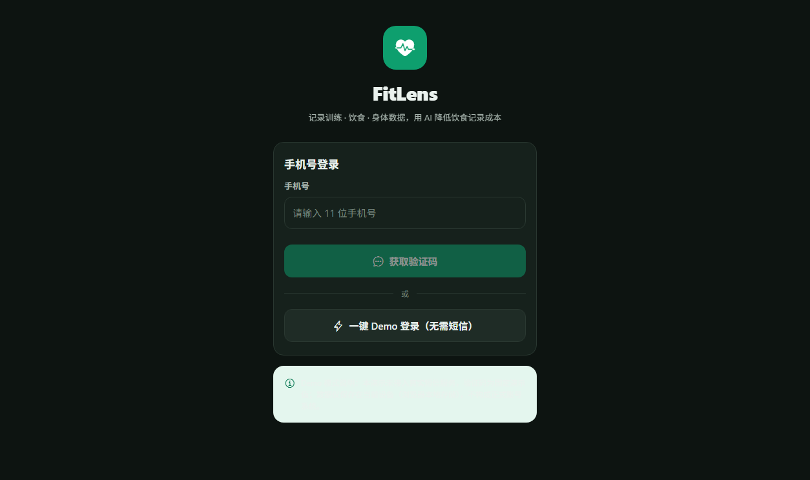
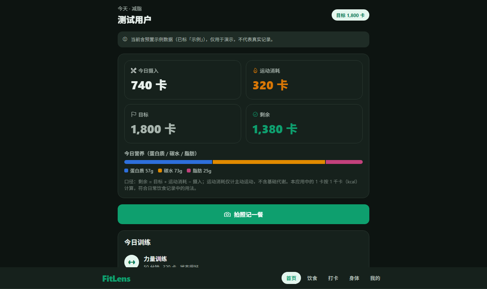

# FitLens — 中文优先的健身与营养记录 App（Demo）

FitLens 是一款**中文优先**的健身与营养记录应用，帮助普通健身人群（减脂 / 增肌 / 保持健康）记录训练、饮食与身体数据，并通过 **AI 食物照片识别**降低「记录吃了什么」这件事的成本。

> 本项目是面向 **蓝色光标 AI Builder 岗位**的完整作品 Demo：一个代码库同时交付 **Web Demo** 与 **移动端 App（Android 优先）**，核心流程端到端可演示、可验证，而非静态页面。

---

## 目录

- [产品定位](#产品定位)
- [核心流程](#核心流程)
- [在线 Demo 链接](#在线-demo-链接)
- [移动端 App 获取与构建](#移动端-app-获取与构建)
- [截图](#截图)
- [技术架构](#技术架构)
- [快速开始（本地运行）](#快速开始本地运行)
- [部署 Web Demo](#部署-web-demo)
- [配置与环境变量](#配置与环境变量)
- [AI 能力边界](#ai-能力边界)
- [Demo 与真实服务的区别](#demo-与真实服务的区别)
- [数据模型](#数据模型)
- [单位与计算口径](#单位与计算口径)
- [AI 评估 / 产品指标 / 迭代路线](#ai-评估--产品指标--迭代路线)
- [已知限制与未实现部分](#已知限制与未实现部分)

---

## 产品定位

| 项 | 说明 |
|---|---|
| 目标用户 | 希望减脂、增肌或保持健康习惯的普通健身人群 |
| 核心问题 | 饮食记录成本高、训练打卡分散、身体变化看不到 |
| 核心价值 | 用 AI 食物识别把「记一餐」从 3 分钟降到 10 秒，并与训练、身体数据汇总成每日热量与趋势总览 |
| 关键取舍 | 优先保证「记录 → 汇总 → 趋势」端到端可用；AI 识别采用「模型估算 + 用户确认/修正」协作流程，而非直接采信 |

**产品原则**（贯穿实现）：
1. **AI 是辅助，不是权威**：识别结果必须可确认、可修正后才保存，展示置信度与不确定性说明。
2. **诚实标注**：所有模拟数据、示例数据、Demo 能力均明确标记，不伪装成真实模型或真实用户数据。
3. **单位统一**：界面一律用「卡」表达热量（1 卡 = 1 kcal，见下方口径说明）。
4. **不做医疗诊断**：身体数据仅做趋势展示，不给极端减重建议。

---

## 核心流程

1. **每日总览**：首页汇总今日摄入、运动消耗、目标与剩余热量，展示今日训练状态、近 7 天消耗与体重趋势。
2. **训练打卡**：新增 / 查看 / 编辑 / 删除训练记录（日期、类型、时长、消耗、感受、备注）。
3. **AI 拍照识别 → 确认 → 保存**：拍摄或上传食物照片 → 获得名称、份量、热量与三大营养素估算 → **确认/修正** → 保存为饮食记录。
4. **身体数据**：记录体重 / 腰围 / 臀围，查看趋势图、最近值与变化幅度。
5. **账户**：Demo 登录（明确标注）或手机号+验证码流程、昵称/头像编辑、健身目标与身体信息设置。

---

## 在线 Demo 链接

✅ **已部署并验证可用**：<https://Gsbdueheie.github.io/fitlens/>

- **部署方式**：GitHub Pages（GitHub Actions 自动构建，工作流见 `.github/workflows/deploy.yml`）。
- **已验证**：链接返回 HTTP 200，登录页 / 首页在无头浏览器中正常渲染、无报错。
- **自动更新**：仓库 `main` 分支每次 `git push` 都会自动重新构建并部署。
- 应用运行在 `/fitlens/` 子路径下（已通过 `app.json` 的 `experiments.baseUrl` 配置）。

---

## 移动端 App 获取与构建

FitLens 使用 **Expo（React Native）** 构建，一套代码同时输出 Web 与移动端。

### 方式一：Expo Go 即时预览（无需账号、无需签名）

1. 手机安装 [Expo Go](https://expo.dev/go)（App Store / Google Play）。
2. 本机运行 `npm start`，用 Expo Go 扫描终端二维码即可真机预览。

### 方式二：构建可安装的 Android APK（需 EAS 账号）

```bash
npx eas-cli@latest build --platform android --profile preview
```

- 生成 `.apk` 后可直接安装到 Android 手机；iOS 安装包需 Apple 开发者账号（本仓库 `app.json` 未配置 iOS bundle id，因此当前**只保证 Android**）。
- 该命令需要登录 Expo 账号（`npx eas-cli@latest login`），首次会提示配置 `projectId`。构建在 Expo 云端完成，本机无需 Android Studio / Xcode。

### 说明

- 我不把「手机浏览器里的网页」称为原生 App：本仓库是真正的 React Native 项目，Expo Go 预览与 EAS APK 均为原生渲染。
- **当前限制**：我未在本环境实际生成 APK（需要 EAS 账号与云构建），也未上架应用商店。已如实标注，并给出可复现的构建命令。

---

## 截图

| 登录页（Demo 模式明确标注） | 首页今日总览 |
| --- | --- |
|  |  |

---

## 技术架构

- **框架**：Expo SDK 58 + React Native 0.88 + React 19 + Expo Router（文件式路由）。
- **跨端复用**：业务逻辑（热量计算、单位换算、数据校验）、数据结构、UI 组件、AI 服务接口**三端共用**；仅导航栏（Web 顶部导航 / 原生底部 Tab）做了平台差异实现。
- **数据存储**：`@react-native-async-storage/async-storage`（Web 自动落到 `localStorage`，原生落到 AsyncStorage）。**这是单设备 Demo 存储，不等于正式账号系统。**
- **图表**：`react-native-svg` 手绘轻量图表（折线/柱状/营养素条），无重型图表库依赖。
- **图标**：`@expo/vector-icons`（Ionicons）。
- **图片选择**：`expo-image-picker`（Web 上传 / 原生拍照+相册）。
- **AI 识别**：`FoodRecognitionService` 接口 + 默认 `Mock` 实现 + 可选 `Real` 实现（见下）。

```
src/
  app/                 # Expo Router 路由（每个文件一个页面）
    _layout.tsx        # 根布局 + 登录守卫（Stack.Protected）
    login.tsx  verify.tsx
    (tabs)/            # 首页 / 饮食 / 打卡 / 身体 / 我的
    food-recognize.tsx # 拍照识别
    food-review.tsx    # 确认/修正/保存（识别、编辑、手动三态复用）
    workout-edit.tsx  body-edit.tsx
  components/          # ui.tsx 基础组件 / charts.tsx 图表 / tab-bar.tsx
  context/app.tsx      # 登录态 + 全量数据 CRUD（持久化）
  lib/                 # 类型、日期、格式化、营养计算、种子数据、存储
  services/ai/         # 识别服务接口 + mock + real + draft
```

---

## 快速开始（本地运行）

要求：Node 22.13+ / 24 / 26（本项目在 Node 23 上验证通过，但 Metro 官方支持范围为 22.13/24.3/26+）。

```bash
npm install
npm run web        # 浏览器打开 Web 版（http://localhost:8081）
# 或
npm start          # 启动 Metro，用 Expo Go 扫码在手机预览
```

### 常用命令

| 命令 | 说明 |
|---|---|
| `npm run web` | 启动 Web 开发服务器 |
| `npm start` | 启动 Metro（Web / Android / iOS） |
| `npx expo export --platform web` | 导出静态 Web 包到 `dist/` |
| `npx tsc --noEmit` | 类型检查 |
| `npx expo lint` | 代码检查 |
| `npx expo-doctor` | 依赖/配置诊断 |

---

## 部署 Web Demo

Web 版导出为纯静态 SPA（`dist/`），可部署到任意静态托管。二选一：

**Netlify（已内置 `netlify.toml`）**
```bash
npm i -g netlify-cli && netlify login
netlify deploy --prod          # 或关联仓库后自动构建
```

**Vercel（已内置 `vercel.json`）**
```bash
npm i -g vercel && vercel login
vercel --prod
```

部署后请**实际打开链接验证**登录与各流程可用，再对外宣称「已部署」。

---

## 配置与环境变量

复制示例配置（**不要提交真实密钥**）：

```bash
cp .env.example .env.local
```

| 变量 | 默认 | 说明 |
|---|---|---|
| `EXPO_PUBLIC_AI_MODE` | `mock` | 设为 `real` 切换到真实多模态识别 |
| `EXPO_PUBLIC_FOOD_API_URL` | 空 | 真实识别后端地址（后端持有密钥） |

**无任何密钥即可运行**：默认 `mock` 模式可完整演示所有流程。

---

## AI 能力边界

- 识别逻辑封装在 `src/services/ai/`，业务页面不感知具体实现，可替换为真实模型。
- **默认 `mock` 实现**：不读取图片真实内容，仅按图片 URI 哈希从一组预设示例中确定性返回一个结果，用于演示「拍照 → 识别 → 确认/修正 → 保存」的完整交互。结果在界面与代码中均明确标注「模拟识别」。
- **`real` 实现（未启用）**：需要自建后端代理——后端持有视觉模型 API 密钥，接收 `{ imageBase64, mimeType }` 并按契约返回识别结果。**密钥绝不写入前端/仓库**。
- **不声称准确率**：本项目不含任何编造评测数据。真实准确率（食物类别准确率、热量误差、用户修正率）是**待验证目标**，评估方案见 [`docs/AI_EVALUATION.md`](docs/AI_EVALUATION.md)。

---

## Demo 与真实服务的区别

| 能力 | Demo 现状 | 真实服务（需接入） |
|---|---|---|
| 登录 | Demo 一键登录 / 固定验证码，明确标注 | 真实短信服务 + 后端账号 |
| 数据保存 | 本机 localStorage / AsyncStorage，单设备 | 云端数据库 + 跨设备同步 |
| 食物识别 | 模拟结果（不读图） | 真实多模态视觉模型 |
| 密钥 | 无需任何密钥 | 后端持有，前端不接触 |

---

## 数据模型

- `UserProfile`：手机号、昵称、头像（本地）、健身目标、自定义目标摄入、身高/年龄/性别、是否 Demo 登录。
- `WorkoutRecord`：日期、类型、时长（分）、消耗（kcal，可空）、备注、主观感受。
- `FoodRecord`：日期、餐次、名称、份量（克）、热量（kcal）、蛋白质/碳水/脂肪（g）、来源（`ai`/`manual`）、是否模拟、置信度、不确定性说明、图片、是否示例。
- `BodyMeasurement`：日期、体重（kg）、腰围/臀围（cm）、备注。
- `ManualBurn`：日期、手动补充的运动消耗（kcal）、备注（与训练记录分开，避免重复计算）。

类型定义见 [`src/lib/types.ts`](src/lib/types.ts)。

---

## 单位与计算口径

- **热量单位**：程序内部统一用 **kcal** 存储与计算，界面显示为「卡」（例如「摄入 1,800 卡」）。**本应用中的 1 卡按 1 千卡（kcal）计算**，符合日常饮食记录习惯。界面不混用 kcal / 千卡 / 卡。
- **每日剩余** = 目标 + 运动消耗 − 摄入。
- **运动消耗** = 当日训练记录 `caloriesBurned` 之和 + 手动补充消耗之和（同一活动只记一处，避免重复）。
- **边界说明**：这里的「运动消耗」仅指**主动运动消耗**，不含基础代谢，**不等于全天总能量消耗**。

---

## AI 评估 / 产品指标 / 迭代路线

- AI 识别评估方案（评测集、标注、指标、低置信度处理、用户修正机制）：[`docs/AI_EVALUATION.md`](docs/AI_EVALUATION.md)
- 产品指标建议（记录完成率、打卡留存、识别后修改率、周活等）：[`docs/METRICS.md`](docs/METRICS.md)
- 后续迭代路线（短期 / 中期）：[`docs/ROADMAP.md`](docs/ROADMAP.md)
- 产品方案说明（用户问题、定位、核心功能、关键取舍）：[`docs/PRODUCT.md`](docs/PRODUCT.md)

---

## 已知限制与未实现部分

诚实声明，以下内容**当前未实现或为模拟**：

1. **真实短信登录**：未接入短信服务，验证码为固定演示值。
2. **真实多模态识别**：未接入，默认使用明确标注的模拟结果。
3. **云端账号与同步**：数据仅存本机单设备，无后端、无跨设备同步。
4. **Android APK 安装包**：未在本环境实际生成（需 EAS 账号云构建），已提供可复现构建命令与 Expo Go 预览方式。
5. **iOS 安装包**：未配置，仅保证 Android。
6. **真实评测数据**：无（准确率等指标是待验证目标，不编造）。

---

## License

MIT（见 `LICENSE`）。
